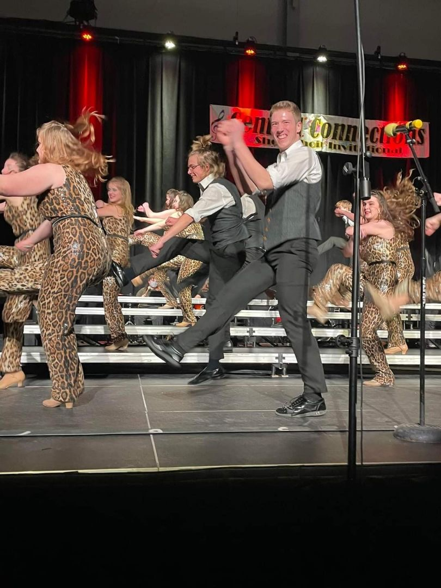
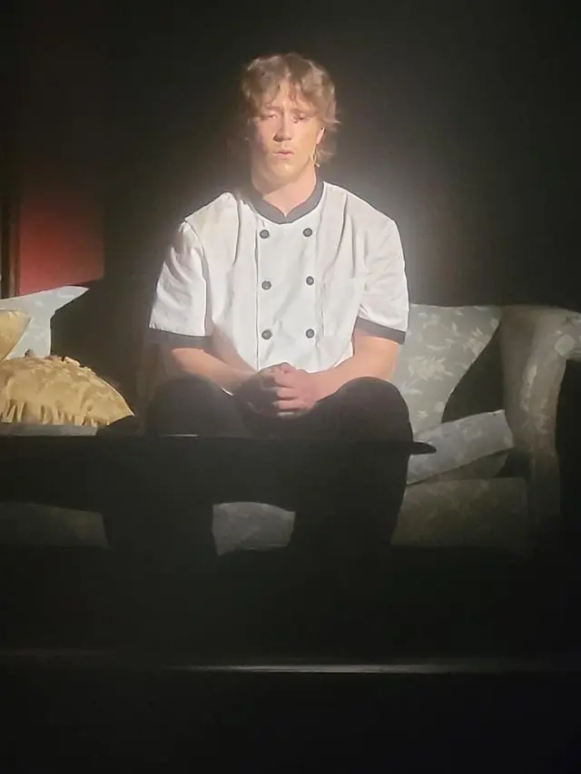
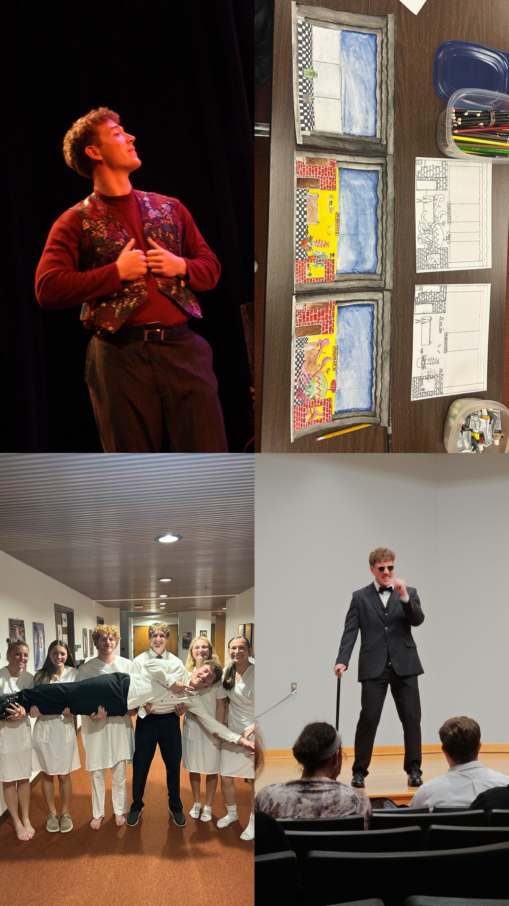
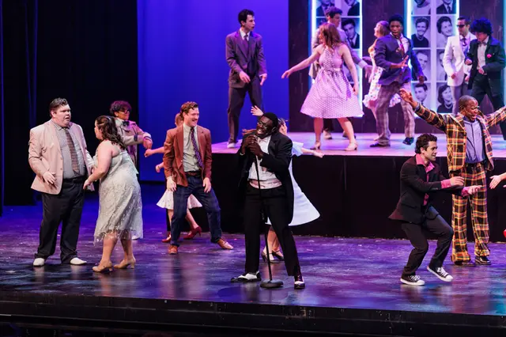

<<<<<<< Updated upstream
## Homepage
- Jorney So Far 
 Image - 

If you added thumnails your self please remove them. Just provided the templeted example we mocked for Mason for him to do so on youtube. Please also remove the Video titled. `Mason Farrignton Intro Video`, that is confirmed by Mason.

## New Resume

[Resume](<../../../../../Downloads/Mason Farrington-2.pdf>)
=======
## Thumbnails

Need a thumbnail template; use the existing thumbnails that were mocked up by you.

 - (Name: Dance Reel)

 - (Acting Reel)

## About Image Sections

- Found the Stage

  Image - 

- First Role, First Spark

  Image - 

  Description - Stepped into my first musical production and was chosen as Dance Captain for the Show Choir my senior year of high school - (everything after that dash is good)

- Went All In

  Image - 

  Description - After exploring "safer" career options, I soon found out that my passion truly lay in performance. So I declared a major in Musical Theatre and immediately explored aspects of the field, including performing, designing, and directing.

- Join American Gothic -> First Regional Contract

  Image - 

  Description - I had the opportunity to join American Gothic Performing Arts as Diesel in *West Side Story* and Ensemble in *Grease* (show titles in italics) for an exciting first professional theatre experience.

- American Got Talent -> Broadway
Description - Working towards reaching the pinnacle of theatre onestep , one lesson, audition, role, and perfomance at a time

- Movie Actor
 Description -  Expanding into film and television, bringing stories to life on screen is a goal for later in my career that iam working towards currently

## Home Page 
- The Jorney so far 
  Image - 
## Issues

- Clicking "Load more" resets the user to the top of the page (this creates a bad UX).
>>>>>>> Stashed changes
